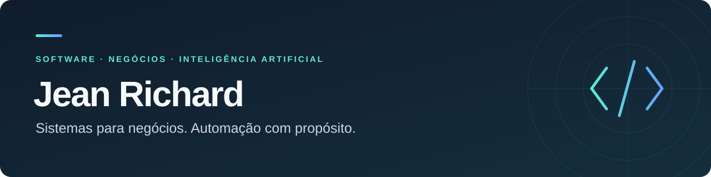

  

# Olá, eu sou Jean Richard 👋

Desenvolvo **sistemas para negócios e automações com inteligência artificial**, com foco em transformar rotinas do dia a dia em soluções práticas.

Meu trabalho conecta interfaces, APIs e dados para simplificar a gestão e aproximar a tecnologia de quem precisa usá-la.

### O que construo

- **Gestão empresarial:** soluções para vendas, estoque, compras e financeiro.
- **E-commerce:** lojas virtuais, painéis administrativos e gestão de conteúdo.
- **Automação com IA:** agentes, integrações com WhatsApp e processamento de documentos.

### Tecnologias que uso

| Área | Tecnologias |
| :--- | :--- |
| Interfaces | TypeScript · React · Vite · Tailwind CSS |
| APIs e serviços | Node.js · NestJS · Python · FastAPI |
| Dados | PostgreSQL · Supabase · Prisma |
| Integrações e entrega | APIs · Webhooks · Docker · GitHub Actions |

### Projeto público em destaque

**[Agente financeiro no WhatsApp ↗](https://github.com/jeannnn19233-cyber/agentewhats)**  
Agente com IA para registrar contas, receitas e gastos por conversa, além de extrair informações de fotos de boletos.

`Python` · `FastAPI` · `OpenAI API` · `Supabase` · `Evolution API`

### Como penso os projetos

Busco interfaces claras, integrações úteis e dados consistentes. A tecnologia precisa ajudar a concluir o trabalho e tornar a rotina mais simples.

---

**Explore o [projeto](https://github.com/jeannnn19233-cyber/agentewhats) ou abra uma [discussão](https://github.com/jeannnn19233-cyber/jeannnn19233-cyber/discussions) para conversar sobre tecnologia e automação.**
